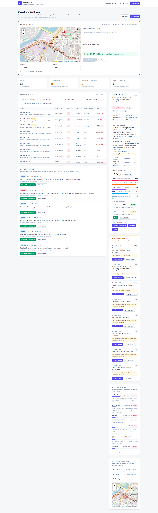
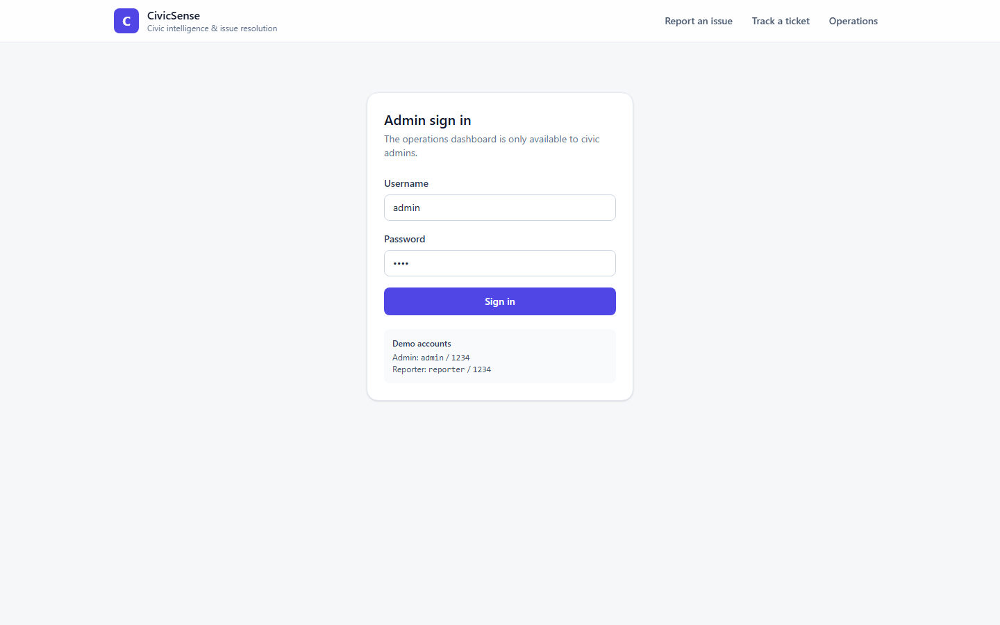
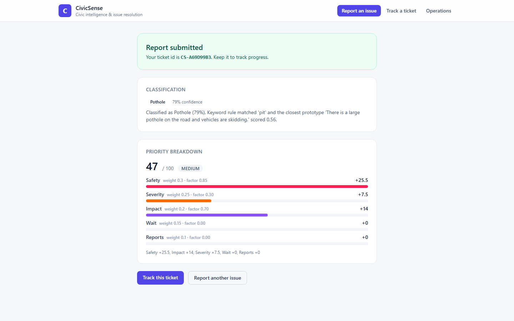
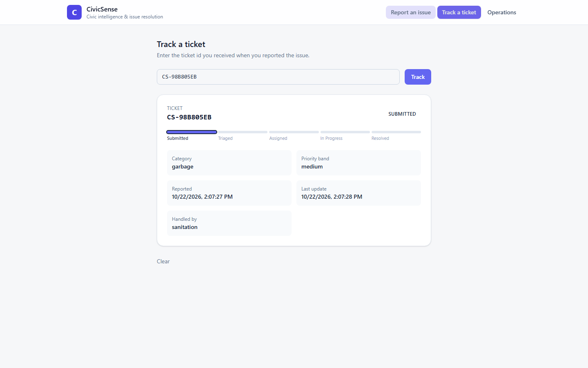

# CivicSense

AI powered civic intelligence and issue resolution for a campus estate.

A citizen reports an issue with a description, a photo and a map pin. CivicSense
classifies the issue, scores its priority, routes it to the right department,
detects duplicates so the same problem is worked once, and flags anything the
model is not confident about for a human to check.



## What it does

| Capability | How |
| --- | --- |
| **Issue classification** | MiniLM sentence embeddings against per-category prototypes, blended with a keyword rule layer. Six categories: pothole, garbage, water leak, streetlight, drainage, other. |
| **Human in the loop** | Low confidence (< 0.50) or a small gap between the top two classes flags the report for review. An admin confirms or overrides the category. |
| **Photo understanding** | Optional zero-shot CLIP classification of the uploaded photo, fused with the text signal. |
| **Priority scoring** | Five weighted factors — safety risk, severity, community impact, wait time, related reports — plus an SLA escalation boost. Every point is explained. |
| **Duplicate detection** | Text cosine similarity + geo proximity + time decay produce `duplicate` and `related` links. A confirmed duplicate is merged into one incident instead of being worked twice. |
| **Hotspot detection** | Recurring clusters of the same category in one place, ranked by count and how many months they have been active. |
| **Routing and SLA** | Category to department rules, a capacity-aware workload view and a response deadline per report. |
| **Audit trail** | Every classification, score, status change, review decision and link merge is written to an append-only log. |
| **Geo spatial** | PostgreSQL + PostGIS, geography points and GiST indexes for radius queries. |

## Screenshots

| | |
| --- | --- |
|  |  |
| Admin sign in | Report submitted with the AI breakdown |
|  | |
| Track a ticket | |

## Tech stack

- **Backend** — FastAPI, SQLAlchemy 2, PostgreSQL 16 + PostGIS 3.6, scikit-learn, sentence-transformers (all-MiniLM-L6-v2), optional CLIP via transformers
- **Frontend** — React 19, TypeScript, Vite, Tailwind CSS 4, React Leaflet, Recharts
- **Auth** — PBKDF2-SHA256 password hashes, opaque session tokens in the database

## Quick start

### Docker (everything at once)

```bash
docker compose up --build
```

- Web app <http://localhost:5173>
- API docs <http://localhost:8000/docs>

The database is seeded automatically with 60 sample reports.

### Windows, without Docker

A portable PostgreSQL + PostGIS lives in `.local\`, so no global install is needed.

```powershell
# 1. database (first run downloads ~430 MB into .local\)
powershell -ExecutionPolicy Bypass -File scripts\local-db.ps1 setup
powershell -ExecutionPolicy Bypass -File scripts\local-db.ps1 start

# 2. backend
cd backend
py -3.11 -m venv ..\.venv
..\.venv\Scripts\pip install -r requirements.txt
..\.venv\Scripts\python scripts\init_db.py
..\.venv\Scripts\python scripts\seed.py --reset
..\.venv\Scripts\python -m uvicorn app.main:app --host 127.0.0.1 --port 8000

# 3. frontend (second terminal)
cd frontend
npm install
npm run dev
```

Or just run `scripts\run.bat` — it starts the database, the API and the web app
and opens the browser. `scripts\run.bat --stop` shuts them down again.

### Demo accounts

| Username | Password | Role |
| --- | --- | --- |
| `admin` | `1234` | admin — full operations dashboard |
| `reporter` | `1234` | reporter — can report, cannot triage |
| `citizen` | `1234` | reporter — walk-in citizen |

Reporting an issue and tracking a ticket work signed out. The operations
dashboard requires an admin sign in.

## Configuration

Copy `.env.example` to `.env` in the repository root and adjust:

| Variable | Default | Meaning |
| --- | --- | --- |
| `DATABASE_URL` | `postgresql+psycopg://postgres@127.0.0.1:5432/civicsense` | Database connection |
| `CIVICSENSE_CORS_ORIGINS` | `http://localhost:5173` | Comma separated allowed origins |
| `CIVICSENSE_EMBED_MODEL` | `all-MiniLM-L6-v2` | Sentence embedding model |
| `CIVICSENSE_MODEL_VERSION` | `minilm-l6-v2@2026-10` | Version stamped on every AI decision |
| `CIVICSENSE_CLIP_ENABLED` | `0` | Enable zero-shot photo classification |
| `CIVICSENSE_CLIP_MODEL` | `openai/clip-vit-base-patch32` | CLIP checkpoint |

Tunables that are not deployment specific — category prototypes, priority
weights, review thresholds, duplicate scoring, routing rules — live in
`backend/app/settings.py`.

## API

| Method | Path | Who | What |
| --- | --- | --- | --- |
| `POST` | `/auth/login` | public | Exchange credentials for a session token |
| `GET` | `/auth/me` | signed in | The session behind the token |
| `POST` | `/auth/logout` | signed in | Revoke the token |
| `POST` | `/complaints` | public | Report an issue (multipart, optional photo) |
| `GET` | `/complaints` | admin | Priority queue, filterable |
| `GET` | `/complaints/{id}` | admin | One report |
| `GET` | `/complaints/{id}/links` | admin | Duplicate matches for a report |
| `GET` | `/complaints/links` | admin | Duplicate inbox |
| `POST` | `/complaints/links/{id}/decision` | admin | Merge or dismiss a suggested duplicate |
| `PATCH` | `/complaints/{id}/status` | admin | Move a ticket through the lifecycle |
| `POST` | `/complaints/{id}/review` | admin | Confirm or override the category |
| `GET` | `/complaints/stats/overview` | admin | Totals |
| `GET` | `/complaints/stats/workload` | admin | Department load against capacity |
| `GET` | `/complaints/stats/hotspots` | admin | Recurring clusters |
| `GET` | `/tickets/{ticket_id}` | public | Track a ticket |
| `GET` | `/health` | public | Liveness and model version |

Interactive documentation lives at <http://localhost:8000/docs>.

## How the AI pieces work

**Classification** blends two signals. The embedding similarity to each
category's prototypes is gated by an absolute floor and by the specificity of
the report, so a vague one-liner cannot look confident. The keyword rule layer
is weighted by how much evidence it found: "choked drain" outweighs a bare
"waterlogging", which is what keeps an ambiguous report from landing on the
wrong category.

**Priority** is a weighted sum of five normalised factors. The contribution of
every factor is stored with the report, so the score can always be explained —
that is what the breakdown panel renders.

**Duplicates** are scored from text similarity, distance and recency. A report
that clears the duplicate thresholds joins the incident of the report it
repeats; weaker candidates stay as suggestions in the duplicate inbox for an
admin to confirm.

## Project layout

```
backend/
  app/
    config.py          runtime configuration and .env loading
    settings.py        categories, weights, thresholds, routing rules
    models.py          SQLAlchemy schema
    schemas.py         request and response models
    deps.py            authentication dependencies
    routers/           auth, complaints, public ticket lookup
    services/          classifier, scorer, duplicates, workflow, embeddings, images, audit
  scripts/             init_db, seed, verify, calibrate, inspect_flags
frontend/
  src/
    pages/             Submit, TicketStatus, Login, Dashboard
    components/        MapPicker, ComplaintDetail, ReviewQueue, DuplicateInbox, WorkloadPanel, HotspotPanel, AddReport, PriorityBreakdown
    api.ts             typed API client
    auth.ts            session storage
scripts/
  local-db.ps1         portable PostgreSQL + PostGIS for Windows
  run.bat              one command launcher
```

## Checks

```powershell
# backend acceptance suite (38 checks)
cd backend; ..\.venv\Scripts\python scripts\verify.py

# headless browser check of the whole flow (23 checks)
cd frontend; npm install; npx playwright install chromium; node scripts\ui-check.mjs

# classifier calibration against the seeded ground truth
cd backend; ..\.venv\Scripts\python scripts\calibrate.py
```

`verify.py` expects the API to be running on port 8000 and seeds are expected
to be in place; `scripts\seed.py --reset --count N` reseeds with a different
number of sample reports.
